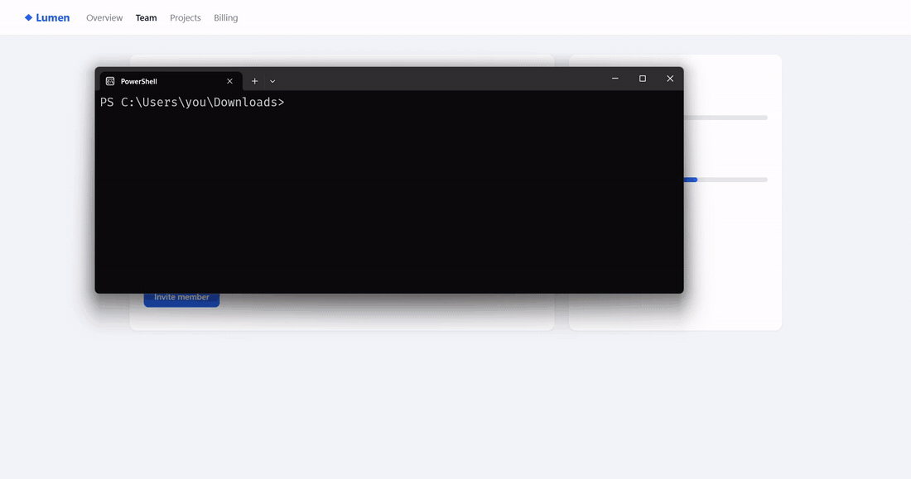
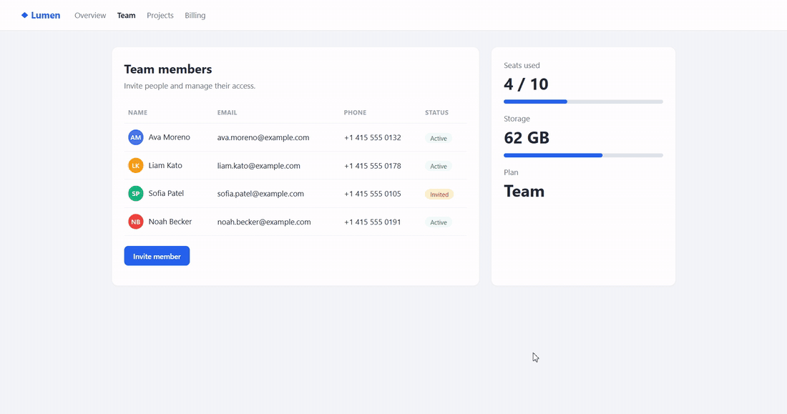
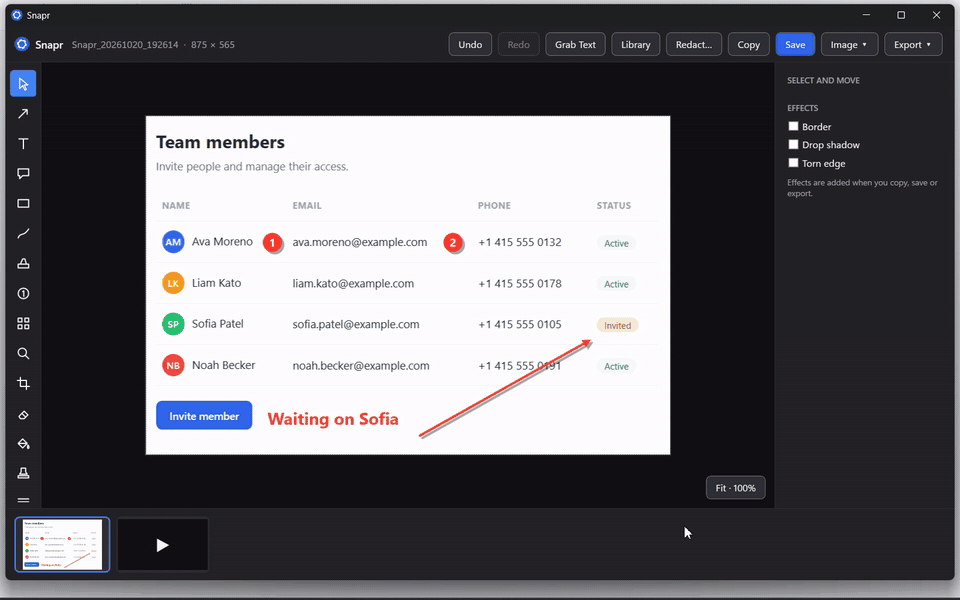
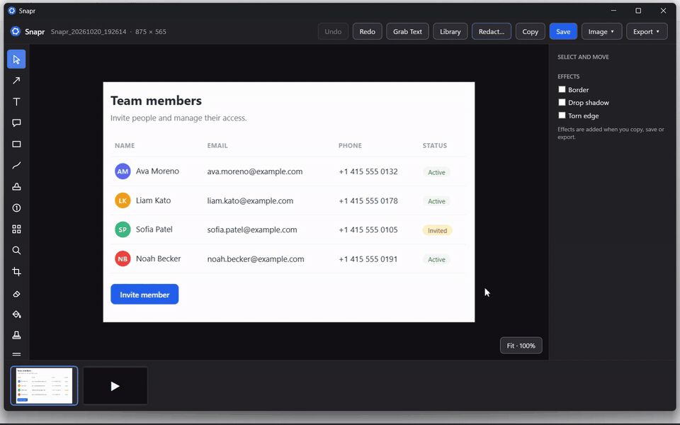

<p align="center">
  
</p>

<p align="center">
  <a href="https://github.com/teransarathchandra/snapr/releases/latest"></a>
  <a href="https://github.com/teransarathchandra/snapr/actions/workflows/ci.yml"></a>
  
  
  <a href="LICENSE"></a>
</p>

<p align="center">
  A free screen capture and annotation tool for Windows.<br>
  No installer, no account, no admin rights. Download one <code>.exe</code> and press <kbd>Print Screen</kbd>.
</p>

<p align="center">
  <a href="https://github.com/teransarathchandra/snapr/releases/latest/download/Snapr.exe"></a>
  <a href="#build-from-source"></a>
</p>

## See it

### 1 · Install in 10 seconds

Download one file and run it. No installer, no admin rights. Snapr waits in the tray.



### 2 · Capture and annotate

Press <kbd>Print Screen</kbd>, drag an area, then add arrows, text and numbered steps. Everything stays editable.



### 3 · Redact in one click

Snapr reads the capture and finds emails, phone numbers, card numbers and web addresses. Type any other word to hide it too.



### 4 · Simplify

Turn a busy screenshot into clean wireframe shapes, ready for docs and slides.



## What's inside

|  |  |
|---|---|
| 📸 **Capture** | Region, window, all screens, scrolling pages and panoramas |
| ✏️ **Annotate** | Arrows, text, callouts, shapes, steps, stamps, blur, spotlight, magnifier |
| 🔒 **Redact** | Find and cover private text automatically, with Windows OCR |
| 🔤 **Grab Text** | Copy the text from any part of the screen |
| 🎬 **Record** | MP4 with system audio, microphone and a webcam bubble |
| ✂️ **Trim and GIF** | Cut videos, annotate them and save MP4 or animated GIF |
| 🗂️ **Library** | Every capture saved, searchable and taggable |
| 📤 **Export** | PNG, JPG, GIF, BMP, PDF or print. Opens Snagit `.snagx` files too |
| 🔗 **Share** | Copy to a share folder, upload to your own endpoint, or use Windows Share |

The full list is in [docs/features.md](docs/features.md).

## Get started

1. **[Download Snapr.exe](https://github.com/teransarathchandra/snapr/releases/latest/download/Snapr.exe)** and run it, or in PowerShell:
   ```powershell
   curl.exe -LO https://github.com/teransarathchandra/snapr/releases/latest/download/Snapr.exe
   .\Snapr.exe
   ```
   > [!NOTE]
   > Snapr.exe isn't code-signed yet, so on first run Windows SmartScreen may say "Windows protected your PC". Choose **More info → Run anyway**. You can check the download against `Snapr.exe.sha256` on the release page.
2. Snapr starts in the tray. Press <kbd>Print Screen</kbd> and drag an area.

**Needs:** Windows 10 1903+ or Windows 11 (x64). Video recording also needs [ffmpeg](https://ffmpeg.org/download.html) on your `PATH` (or set its location in Settings).

| Hotkey | Action |
|---|---|
| <kbd>Print Screen</kbd> | Capture image |
| <kbd>Shift</kbd> + <kbd>Print Screen</kbd> | Record video (press again to stop) |
| <kbd>Ctrl</kbd> + <kbd>Print Screen</kbd> | Scrolling capture |
| <kbd>Ctrl</kbd> + <kbd>Alt</kbd> + <kbd>Print Screen</kbd> | Repeat last capture |

Every hotkey can be changed in Settings. Editor shortcuts and file locations: [docs/features.md](docs/features.md#shortcuts).

## Build from source

Needs the [.NET 10 SDK](https://dotnet.microsoft.com/download/dotnet/10.0).

```powershell
dotnet test
dotnet run --project src/Snapr.App
```

## Contributing

Issues and pull requests are welcome. See [CONTRIBUTING.md](CONTRIBUTING.md). Security reports: [SECURITY.md](SECURITY.md).

Released under the [MIT licence](LICENSE). ffmpeg is not bundled with Snapr.
